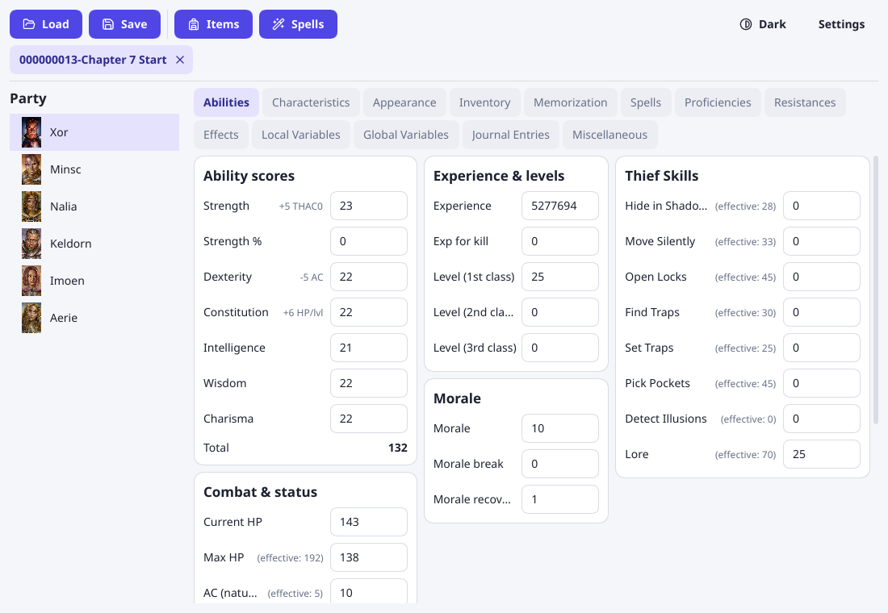
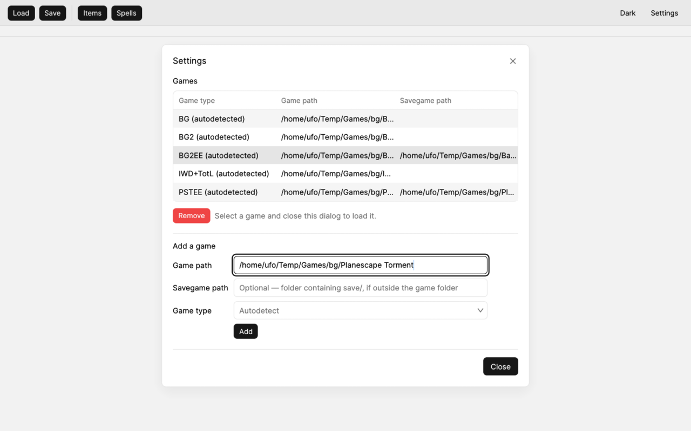

# Infinitier Keeper

A save-game editor for the Infinity Engine games. Inspired by ShadowKeeper,
EEKeeper and JSEEKeeper, but one binary works across every engine, and all
game-specific knowledge (names, tables, limits) is read from your installed
game rather than hard-coded.



## Supported games

| Game | Expansions / variants |
| --- | --- |
| Baldur's Gate | Tales of the Sword Coast |
| Baldur's Gate: Enhanced Edition | Siege of Dragonspear |
| Baldur's Gate II | Shadows of Amn, Throne of Bhaal |
| Baldur's Gate II: Enhanced Edition | |
| Icewind Dale | Heart of Winter, Trials of the Luremaster |
| Icewind Dale: Enhanced Edition | |
| Icewind Dale II | |
| Planescape: Torment | |
| Planescape: Torment: Enhanced Edition | |

The Enhanced Edition Trilogy (EET) and BG1 Tutu mods are recognised too.
What each editor tab can change differs per game; see
[What you can edit](#what-you-can-edit).

## Platforms

Pre-built binaries for **Linux** (x86_64), **Windows** (x86_64) and **macOS**
(Apple Silicon and Intel) are attached to each
[GitHub release](https://github.com/ufoscout/infinitier/releases).
Development and testing happen on Linux.

To build from source (requirements in the [root README](../../README.md#building)):

```sh
cargo run --release -p infinitier_keeper
```

## Configuration

The keeper keeps its settings in `infinitier_keeper.toml` in the folder it is
started from. Pass `--config <file>` to use another file.

Each game has:

- **`game_path`** — the install folder, the one containing `CHITIN.KEY`.
- **`save_path`** (optional) — the folder containing the `save/` directory,
  when it isn't inside the install; see [where each game keeps it](#1-add-a-game).
- **`game_type`** (optional) — forces the game type instead of detecting it
  from the install. Pick it in the Settings dialog.

`--log <filter>` sets the log level, e.g. `--log warn`.

## Add a game

Click **Settings** in the top-right corner. Under **Add a game**, enter the
game folder and, for an Enhanced Edition, its savegame folder, then click
**Add**. Leave **Game type** on *Autodetect* unless detection gets it wrong;
the list shows the detected type next to each game.

**Browse…** next to a path opens your system's folder picker instead. On
Linux that is your desktop's own picker, through the XDG desktop portal
(`xdg-desktop-portal-gnome`, `-kde` or `-gtk`; Sway and Hyprland need `-gtk`
next to their own portal), with `zenity` as the fallback.

**Why a separate savegame folder?** The original games write their saves into
a `save/` folder inside the install folder, so the game path is all the keeper
needs. The Enhanced Editions instead keep saves (with portraits and other
per-user files) in a folder in your user profile, away from the install. Point
**Savegame path** at that folder, the one containing `save/`; picking `save/`
itself works too, and the keeper keeps the folder above it. It reads every
save folder in there: `save/`, `mpsave/` (multiplayer), `sodsave/` (Siege of
Dragonspear) and the others, plus your exported characters. A folder with no
save folder in it is refused.

| Game | Windows | Linux |
| --- | --- | --- |
| Baldur's Gate, Baldur's Gate II, Icewind Dale, Icewind Dale II, Planescape: Torment | *leave empty* (`<install>\save`) | *leave empty* (`<install>/save`) |
| Baldur's Gate: EE (and Siege of Dragonspear) | `%USERPROFILE%\Documents\Baldur's Gate - Enhanced Edition` | `~/.local/share/Baldur's Gate - Enhanced Edition` |
| Baldur's Gate II: EE (and EET) | `%USERPROFILE%\Documents\Baldur's Gate II - Enhanced Edition` | `~/.local/share/Baldur's Gate II - Enhanced Edition` |
| Icewind Dale: EE | `%USERPROFILE%\Documents\Icewind Dale - Enhanced Edition` | `~/.local/share/Icewind Dale - Enhanced Edition` |
| Planescape: Torment: EE | `%USERPROFILE%\Documents\Planescape Torment - Enhanced Edition` | `~/.local/share/Planescape Torment - Enhanced Edition` |

- **Running a Windows version under Wine on Linux:** the Enhanced Editions use
  the Windows path inside the Wine prefix, e.g.
  `~/.wine/drive_c/users/<you>/Documents/Baldur's Gate - Enhanced Edition`.
- **An original game installed under `Program Files`:** Windows may redirect
  its saves to
  `%LOCALAPPDATA%\VirtualStore\Program Files (x86)\<install folder>`; if the
  install's `save\` folder is empty, use that folder as the savegame path.



## Development

The keeper is a [Slint](https://slint.dev) UI over the `infinitier_core` data
layer (game-data indexing, save discovery, GAM/CRE parse + export, engine
caps). It is built entirely on the
[slint-themekit](https://github.com/ufoscout/slint-themekit) component library
(no `std-widgets`), so one `Theme` value styles everything.

### Build prerequisites

- **slint-themekit**: for now a path dependency on a sibling checkout. Clone
  it so that `../../../github_ufoscout/slint-themekit` (relative to the
  workspace root) exists; `.vscode/settings.json` points the Slint language
  server at the same checkout.
- **fontconfig** on Linux: Slint's text stack links it at build time, so the
  dev package is needed (the runtime `libfontconfig.so.1` alone isn't):

  ```sh
  sudo apt install libfontconfig1-dev      # Debian/Ubuntu
  sudo dnf install fontconfig-devel        # Fedora
  ```

  No GL / GPU library is needed: the keeper uses Slint's software renderer
  with the winit backend. Windows and macOS need no extra system package.

### Verifying the UI

The keeper can expose Slint's embedded MCP server for automated / AI-driven UI
inspection (see [`docs/slint_mcp.md`](../../docs/slint_mcp.md)):

```sh
SLINT_EMIT_DEBUG_INFO=1 SLINT_MCP_PORT=8080 SLINT_BACKEND=headless \
cargo run -p infinitier_keeper --features mcp -- --config config_test/infinitier_keeper.toml
```

### Layout

The UI is split like Slint's demo apps:

- `ui/app.slint` — the window: composes the parts below and switches the
  themekit's `Theme` between its Light and Dark presets;
  `ui/themes/metrics.slint` — the keeper's own layout values (the only
  `.slint` file with literal sizes; `tests/ui_tokens.rs` enforces it, and
  that nothing imports `std-widgets`).
- `ui/components/` — the keeper's own widgets on themekit components
  (floating window, field card; every table is a themekit `Table`);
  `ui/shell/` — header, save tabs, party list, character panel; `ui/tabs/` —
  the character tabs' pages; `ui/browser/` — the Item / Spell Browser
  windows; `ui/dialogs/` — the modal dialogs. Each part reads and calls its
  `*Adapter` global.
- `build.rs` — compiles the `.slint` via `slint-build` and bakes in the git
  version.
- `src/main.rs` — clap args and startup; `src/app.rs` — the top-level state
  (no game / game / open saves) and background game loading; `src/view/` —
  fills the adapters, per UI part; `src/callbacks/` — handles their
  callbacks, per UI part; `src/tabs/` — one module per character tab;
  `src/components/` — the shared field logic and the tables' cells;
  `src/dialogs/` — the dialogs' state; `src/browser/` — the browsers'
  indexes and add logic. The settings file and the Settings dialog's state
  are shared with the explorer, in the `infinitier_gui_common` crate
  (`src/infinitier_gui_common/`).

`PORT_STATUS.md` and `THEMEKIT_MIGRATION.md` record how this UI was built.
